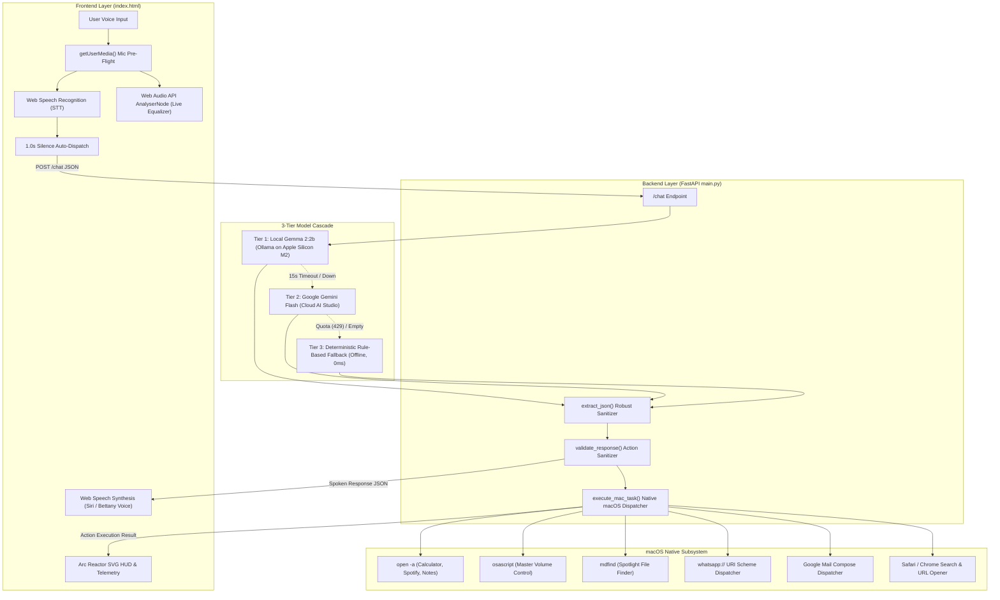

# J.A.R.V.I.S. System Pattern & Architectural Specification

This document provides the complete, unified architectural pattern, protocol contracts, data flows, and implementation details for the **J.A.R.V.I.S. Voice-First Holographic AI Command System** on macOS.

---

## 1. System Topology & Architecture



---

## 2. Frontend Voice & Audio Pattern (`index.html`)

### A. Microphone Permission Pre-flight
Chrome blocks audio features unless triggered by a clean permission grant:
```javascript
// Pre-flight microphone permission
const stream = await navigator.mediaDevices.getUserMedia({ audio: true });
const audioContext = new (window.AudioContext || window.webkitAudioContext)();
const source = audioContext.createMediaStreamSource(stream);
const analyser = audioContext.createAnalyser();
analyser.fftSize = 64;
source.connect(analyser);
```

### B. Real-Time Audio Frequency Visualizer
Equalizer bars dynamically react to your physical voice volume:
```javascript
const dataArray = new Uint8Array(analyser.frequencyBinCount);
function renderVisualizer() {
    requestAnimationFrame(renderVisualizer);
    analyser.getByteFrequencyData(dataArray);
    const average = dataArray.reduce((a, b) => a + b, 0) / dataArray.length;
    // Animate HUD rings & equalizer bars based on average frequency amplitude
    hudCore.style.transform = `scale(${1 + (average / 255) * 0.15})`;
}
```

### C. Continuous Speech Recognition with Silence Detection
```javascript
const recognition = new webkitSpeechRecognition();
recognition.continuous = true;
recognition.interimResults = true;

let silenceTimer = null;
recognition.onresult = (event) => {
    const transcript = Array.from(event.results)
        .map(result => result[0].transcript)
        .join('');
    
    // Auto-dispatch after 1.0s pause in speaking
    clearTimeout(silenceTimer);
    silenceTimer = setTimeout(() => {
        if (transcript.trim()) {
            dispatchToJarvis(transcript.trim());
        }
    }, 1000);
};
```

### D. Voice Output (Text-To-Speech)
Filter for a distinguished British male voice matching J.A.R.V.I.S.:
```javascript
function speakJarvis(text) {
    window.speechSynthesis.cancel();
    const utterance = new SpeechSynthesisUtterance(text);
    const voices = window.speechSynthesis.getVoices();
    // Prioritize Paul Bettany / British male sound profiles
    const selectedVoice = voices.find(v => 
        (v.name.includes("Daniel") || v.name.includes("Oliver") || v.name.includes("Arthur")) && 
        v.lang.startsWith("en")
    ) || voices.find(v => v.lang.startsWith("en"));
    
    if (selectedVoice) utterance.voice = selectedVoice;
    utterance.pitch = 0.95;
    utterance.rate = 1.05;
    window.speechSynthesis.speak(utterance);
}
```

---

## 3. Backend AI Orchestration Pattern (`main.py`)

### A. The 3-Tier Multi-Model Cascade
```python
def process_chat(user_text: str):
    # Tier 1: Local Gemma 2 via Ollama (Apple Silicon M2)
    try:
        return call_local_gemma(chat_history)  # 15s timeout
    except Exception:
        pass

    # Tier 2: Cloud Google Gemini Flash
    try:
        api_key = os.getenv("GEMMA_API_KEY") or os.getenv("HF_TOKEN")
        if api_key:
            return call_google_ai_studio(chat_history, api_key)
    except Exception:
        pass

    # Tier 3: Zero-Latency Deterministic Rule Engine
    return fallback_jarvis_engine(user_text)
```

### B. Robust JSON Extraction Pattern
Prevents syntax crashes when LLMs wrap output in markdown code blocks:
```python
def extract_json(raw_text: str) -> Dict[str, Any]:
    cleaned = raw_text.strip()
    cleaned = re.sub(r"^```(?:json)?\s*", "", cleaned, flags=re.IGNORECASE)
    cleaned = re.sub(r"\s*```$", "", cleaned).strip()
    
    try:
        return json.loads(cleaned)
    except json.JSONDecodeError:
        match = re.search(r"\{[\s\S]*\}", cleaned)
        if match:
            return json.loads(match.group(0))
    
    return {"reply": cleaned[:200], "action": {"command": "NONE"}}
```

---

## 4. Native macOS Automation Pattern

Rather than bulky third-party dependencies, system tasks execute directly using native macOS command-line utilities via `subprocess`:

| Command | Native macOS Utility | Implementation Pattern |
|---|---|---|
| **App Launching** | `open -a` | `subprocess.Popen(["open", "-a", app_name])` |
| **System Volume** | `osascript` | `subprocess.run(["osascript", "-e", f"set volume output volume {vol}"])` |
| **File Search** | `mdfind` (Spotlight) | `subprocess.check_output(["mdfind", f"kMDItemDisplayName == '*{filename}*'cdw"])` |
| **WhatsApp Message** | `whatsapp://` URI | `subprocess.Popen(["open", f"whatsapp://send?phone={phone}&text={msg}"])` |
| **Gmail Compose** | Google Mail Web URL | `subprocess.Popen(["open", f"https://mail.google.com/mail/?view=cm&to={to}&su={subject}&body={body}"])` |
| **Calculate & Math** | Python `eval` + Calculator | Solves expression arithmetic and triggers `open -a Calculator` |
| **Web Search** | Default Browser | `subprocess.Popen(["open", f"https://www.google.com/search?q={query}"])` |

---

## 5. JSON Action Contract (Model Protocol)

The prompt enforces a strict JSON schema contract between the LLM and the operating system:

```json
{
  "reply": "<Spoken voice response in Paul Bettany / J.A.R.V.I.S. persona>",
  "action": {
    "command": "<CALCULATE | FIND_FILE | OPEN_APP | SET_VOLUME | SEND_WHATSAPP | SEND_EMAIL | SEARCH_WEB | OPEN_URL | SYSTEM_SCAN | ACTIVATE_DEFENSE | DEPLOY_WIDGET | STAND_DOWN | NONE>",
    "expression": "<Math string for CALCULATE, e.g. 26 * 25>",
    "result": "<Calculated answer, e.g. 650>",
    "filename": "<Filename for FIND_FILE, e.g. notes.txt>",
    "app_name": "<Target application, e.g. Spotify, Calculator, Notes>",
    "volume": 75,
    "phone": "<Phone number or contact name>",
    "message": "<WhatsApp message body>",
    "to": "<Recipient email address>",
    "subject": "<Email subject line>",
    "body": "<Email message body>",
    "query": "<Search query>",
    "url": "<Target URL>"
  }
}
```

---

## 6. Resilience & Safety Principles

1. **Never Break Working Automations**: If the LLM generates a conversational reply but returns `command: "NONE"`, the deterministic parser re-evaluates the query to catch commands like *"calculate 26*25"* or *"open Spotify"*.
2. **Empty Candidate Protection**: Safe parsing protects against Google Gemini rate-limits (429) or empty safety blocks.
3. **Bounded Context**: Conversation memory buffer caps at 50 turns to prevent token bloat and memory leaks.
4. **Zero-Latency Offline Guarantee**: If internet drops or Ollama is stopped, the offline rule engine handles all system tasks with zero latency.

---

## 7. Execution & Development Commands

```bash
# 1. Start Ollama local model (in background)
ollama serve &
ollama run gemma2:2b

# 2. Run Jarvis Server
./run.sh
# Access the HUD at: http://localhost:8000
```
