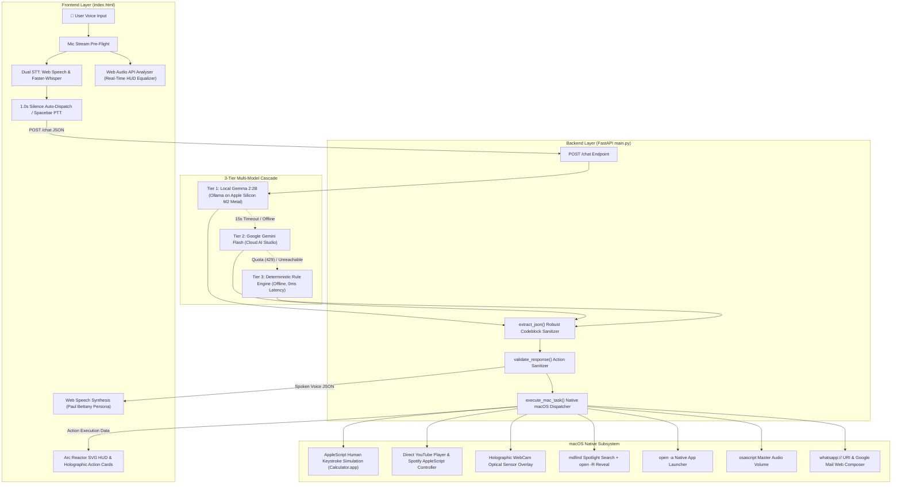

# 🤖 J.A.R.V.I.S. — Voice-First Holographic AI Command System for macOS

[](https://github.com/Mahmadyaseen06/Jarvis)
[](https://python.org)
[](https://fastapi.tiangolo.com)
[-f59e0b?logo=google)](https://ollama.com/library/gemma2)
[](https://github.com/SYSTRAN/faster-whisper)
[](https://apple.com)

An authentic **Iron Man J.A.R.V.I.S.** Voice-First Holographic AI Command System engineered for **macOS**. Built with **FastAPI**, **vanilla HTML/JS/CSS**, **Local Gemma 2:2B** (Ollama on Apple Silicon M2 with Metal GPU acceleration), **Google Gemini Flash**, and on-device **Faster-Whisper** neural speech recognition.

J.A.R.V.I.S. bridges conversational AI directly into the macOS operating system: controlling applications, typing human-like keystrokes into Calculator.app, streaming media directly in HUD cards, executing deep Spotlight file searches with Finder reveal, operating an optical HUD camera with scanlines, and responding with Paul Bettany's iconic British cadence.

---

## 🏛️ System Architecture



---

## ✨ Core Features & Innovations

### 1. ⚡ Arc Reactor Holographic HUD (`index.html`)
- **Stark Industries Aesthetic**: Sleek obsidian canvas (`#05080c`) punctuated by holographic cyan (`#00f0ff`) and gold accents with geometric gridlines.
- **Interactive Arc Reactor Core**: Central SVG core pulses with breathing animations. Clicking the core or pressing the **Spacebar** triggers hands-free voice capture.
- **Dynamic Equalizer & Audio Waveform**: Web Audio API `AnalyserNode` drives real-time audio reactive equalizer bars and core scale oscillations matched to your physical vocal amplitude.
- **Tactical Red Alert Mode**: High-voltage transition transforms all HUD elements from standby cyan to emergency crimson with flashing status banners.

### 2. 🎙️ Dual-Engine Speech-to-Text Pipeline
- **Local Faster-Whisper Neural STT**: High-accuracy on-device speech transcription endpoint (`POST /api/transcribe`) running quantized Whisper models.
- **Web Speech API**: Low-latency streaming transcription with continuous listening and an automatic 1.0s pause auto-dispatch timer.
- **Spacebar Push-to-Talk**: Instant keyboard shortcut toggles recording and dispatches voice commands without touching the mouse.

### 3. ⌨️ Human Desktop Calculator Keystroke Simulation
- Executes math by orchestrating macOS **System Events** via AppleScript (`human_type_calculator`).
- Automatically launches/focuses `Calculator.app`, clears the memory (`c`), and sequentially types each digit and arithmetic operator with realistic human-paced delays (0.08s).
- Visualizes the executed sequence on the HUD with animated keystroke badges (e.g. `[2] ➔ [6] ➔ [×] ➔ [2] ➔ [5] ➔ [=]`).

### 4. 🎬 Direct Media Playback & Autoplaying Player
- **YouTube In-HUD Streaming**: Automatically embeds an autoplaying YouTube video player directly inside the J.A.R.V.I.S. holographic action card when you request music, trailers, or videos.
- **Spotify Integration**: Executes AppleScript commands to activate Spotify desktop and stream search targets in the background.

### 5. 📷 Holographic HUD Optical Camera
- Built-in biometric camera sensor overlay featuring scanning gridlines, a central targeting reticle, and live mirrored webcam video.
- Includes a 1-click **Snapshot** capture button that renders frames directly to downloadable PNGs.

### 6. 🔍 Deep macOS Spotlight Search (`mdfind`) & Finder Reveal
- 3-tier Spotlight querying (`kMDItemDisplayName` → `kMDItemFSName` → full-text).
- Returns live matching system paths on the HUD with a **"Reveal in Finder"** button powered by `POST /api/reveal` (`open -R`).

### 7. 🧠 3-Tier Multi-Model Cascade
1. **Tier 1 (Local Gemma 2:2B)**: Runs completely offline on Apple Silicon M2 via Ollama with Metal GPU acceleration for private, zero-subscription inference.
2. **Tier 2 (Google Gemini Flash)**: Fast cloud reasoning fallback when complex general knowledge is queried.
3. **Tier 3 (J.A.R.V.I.S. Rule Engine)**: Zero-latency deterministic fallback engine guaranteeing 100% command execution reliability even with zero internet or stopped LLM servers.

---

## 📋 Voice Command Reference Matrix

| Command | Action Executed | Example Voice Prompt |
|---|---|---|
| `CALCULATE` | Types calculation into macOS Calculator with keystrokes + HUD badges | *"Jarvis, calculate 26 times 25"* / *"Open calculator and type the calculation"* |
| `PLAY_MEDIA` | Plays YouTube video directly in HUD card or launches Spotify track | *"Jarvis, play Interstellar soundtrack on YouTube"* / *"Play Bohemian Rhapsody on Spotify"* |
| `ACTIVATE_CAMERA` | Opens holographic camera HUD overlay with live reticle scan | *"Jarvis, activate camera and scan optical sensor"* |
| `FIND_FILE` | Searches macOS Spotlight & provides 1-click Reveal in Finder | *"Jarvis, find file main.py in system"* |
| `OPEN_APP` | Launches native macOS application via `open -a` | *"Jarvis, open Notes app"* / *"Open Safari"* |
| `SET_VOLUME` | Adjusts master system audio level (0–100%) via `osascript` | *"Jarvis, set volume to 65 percent"* |
| `SEND_WHATSAPP` | Auto-dispatches message via `whatsapp://` URI & web fallback | *"Jarvis, send WhatsApp message to Alex saying I will arrive at 7 PM"* |
| `SEND_EMAIL` | Opens pre-populated Google Mail composition tab | *"Jarvis, send email to boss@stark.com with subject Status and body Nominal"* |
| `SEARCH_WEB` | Executes web search in default macOS browser | *"Jarvis, search the web for quantum computing advances"* |
| `SYSTEM_SCAN` | Sweeps laser reticle across HUD and prints diagnostic matrix | *"Jarvis, run a full system diagnostic scan"* |
| `ACTIVATE_DEFENSE`| Switches HUD to emergency crimson alert state | *"Engage combat mode and activate defense protocols"* |
| `DEPLOY_WIDGET` | Deploys glassmorphic live telemetry widget to dashboard | *"Deploy widget Arc Reactor Thermal Output"* |
| `STAND_DOWN` | Returns HUD from defense red back to cyan standby | *"Stand down Jarvis, return to normal status"* |
| `NONE` | Natural British conversational banter with persistent memory | *"Jarvis, what is the meaning of life?"* |

---

## 🚀 Quick Setup & Run Instructions

### 1. Prerequisites
- **macOS** (Apple Silicon M-Series or Intel)
- **Python 3.10+**
- **Google Chrome** (recommended for Web Speech API and Web Audio API support)
- *(Optional)* [Ollama](https://ollama.com) for on-device Local Gemma 2:2B

### 2. Installation

```bash
# 1. Clone repository
git clone https://github.com/Mahmadyaseen06/Jarvis.git
cd Jarvis

# 2. Create and activate Python virtual environment
python3 -m venv .venv
source .venv/bin/activate

# 3. Install dependencies
pip install -r requirements.txt
```

### 3. (Optional) Run On-Device Gemma 2 Model
To enable local Metal GPU accelerated inference on Apple Silicon:
```bash
ollama run gemma2:2b
```

*(If Ollama is not installed, J.A.R.V.I.S. seamlessly falls back to Gemini Cloud or the built-in offline rule engine!)*

### 4. (Optional) Configure Cloud API Keys
```bash
cp .env.example .env
```
Add your Google Gemini API key or Hugging Face token in `.env`:
```env
GEMMA_API_KEY=your_gemini_or_huggingface_key_here
```

### 5. Launch J.A.R.V.I.S.

```bash
# Option A: Start using convenience script
./run.sh

# Option B: Run via Python launcher
python3 run.py

# Option C: Direct uvicorn server
uvicorn main:app --reload --port 8000
```

Open your browser and navigate to:
```
http://localhost:8000
```

---

## 🎯 60-Second Live J.A.R.V.I.S. Demo Script

Follow this script to experience the full breadth of macOS automation and holographic intelligence:

1. **Activate Voice Link**:
   - Tap the central **Arc Reactor Core** or press the **Spacebar**. The core begins pulsing cyan as the audio equalizer reacts to your voice.
2. **Execute Human Calculator Keystrokes**:
   - Speak:
     > *"Jarvis, open calculator and type the calculation 26 times 25"*
   - 💻 Watch macOS `Calculator.app` focus in real time as J.A.R.V.I.S. types `2`, `6`, `×`, `2`, `5`, and hits `=`, displaying keystroke badges on the HUD.
3. **Stream Media Directly on the HUD**:
   - Speak:
     > *"Jarvis, play Interstellar soundtrack on YouTube"*
   - 🎬 An embedded YouTube video player renders right inside your holographic HUD and begins playback.
4. **Deploy Optical Camera Overlay**:
   - Speak:
     > *"Jarvis, activate camera and scan optical sensor"*
   - 📷 The HUD opens a live scanline webcam feed with biometric targeting reticle and instant PNG screenshot capabilities.
5. **Search Files with Finder Reveal**:
   - Speak:
     > *"Jarvis, find file main.py in system"*
   - 🔍 Spotlight locates the file instantly; click **"Reveal in Finder"** to open Finder directly to that folder.
6. **Engage Tactical Defense Protocols**:
   - Speak:
     > *"Engage defense protocols and activate red alert"*
   - 🚨 The entire HUD instantly flashes crimson emergency status with audio alert alarms.
7. **Stand Down**:
   - Speak:
     > *"Stand down Jarvis, return to standby"*
   - 🟢 All systems smoothly transition back to standard cyan status.

---

## 🧪 Automated Test Suite

Verify all 17 system commands, endpoints, and automation bridges:

```bash
python3 test_app.py
```

Output:
```
============================================================
🤖 RUNNING J.A.R.V.I.S. HOLOGRAPHIC DASHBOARD INTEGRATION TESTS
============================================================
✅ 1. GET / (index.html): OK
✅ 2. POST /chat (SYSTEM_SCAN): OK
✅ 3. POST /chat (ACTIVATE_DEFENSE): OK
✅ 4. POST /chat (DEPLOY_WIDGET): OK
✅ 5. POST /chat (OPEN_APP): OK
✅ 6. POST /chat (SET_VOLUME): OK
✅ 7. POST /chat (SEND_WHATSAPP): OK
✅ 8. POST /chat (SEND_EMAIL): OK
✅ 9. POST /chat (CALCULATE): OK
✅ 9b. POST /chat (HUMAN CALCULATOR): OK
✅ 10. POST /chat (FIND_FILE): OK
✅ 11. POST /chat (Flexible WhatsApp): OK
✅ 11b. POST /chat (Automated Message by Name): OK
✅ 12. POST /chat (NONE / Chatting): OK
✅ 13. GET /history: 26 messages preserved in context.
✅ 7. POST /clear: Context memory successfully purged.
✅ 14. POST /api/transcribe: Local Faster-Whisper audio transcription verified.
✅ 15. POST /chat (PLAY_MEDIA Spotify): OK
✅ 15b. POST /chat (PLAY_MEDIA YouTube): OK
✅ 16. POST /chat (ACTIVATE_CAMERA): OK
============================================================
🎉 ALL TESTS PASSED! J.A.R.V.I.S. AI System Dashboard is 100% verified.
============================================================
```

---

## 📁 Repository Structure

```
Jarvis/
├── main.py              # FastAPI server, 3-tier AI cascade, & native macOS automation engine
├── index.html           # Holographic Arc Reactor HUD with Web Audio visualizer & action cards
├── test_app.py          # 17-point integration test suite
├── requirements.txt     # Python dependencies (fastapi, uvicorn, faster-whisper, etc.)
├── run.sh               # Quick-launch bash script with virtualenv auto-activation
├── run.py               # Cross-platform Python launcher
├── PATTERN.md           # Unified system architectural specification & sequence flows
├── NOTES.md             # Development log, failure modes, & bug fix history
├── .env.example         # Configuration template for cloud LLM API keys
└── README.md            # Complete project documentation & live demo guide
```

---

## 🛡️ Privacy & Offline Security

- **100% Offline Capability**: When configured with Local Gemma 2 and Faster-Whisper, audio processing, neural reasoning, and macOS automations execute entirely on your machine.
- **Zero Data Leakage**: Offline rule engine and local models never transmit audio or query telemetry outside your local network.
